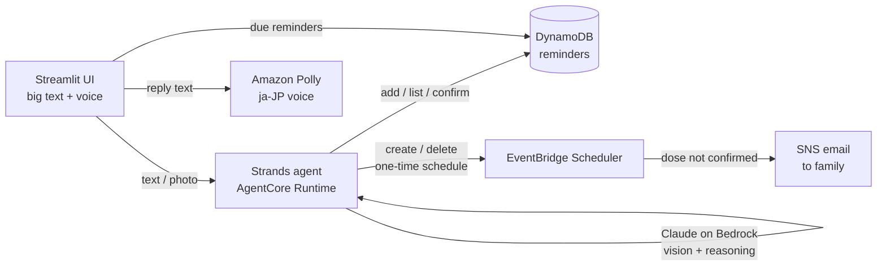

# 🌸 Yorisoi (よりそい) — a care companion agent for older adults in Japan

Yorisoi ("staying close") is an AI agent built with the **Strands Agents SDK** and deployed on **Amazon Bedrock AgentCore Runtime**. It helps older adults who live alone remember medicine and appointments, understand letters and medicine bags, and stay connected to family when something goes wrong.

> Focus area: **Health** — Strands SDK: Workshop to Ship hackathon

## The problem

Japan is the world's most aged society, and the number of older people living alone keeps rising while the care workforce cannot keep up.
<!-- TODO: add 2-3 figures with sources, e.g. 内閣府「高齢社会白書」(share aged 65+, people living alone)
     and 厚生労働省 care-worker shortage estimate. Link each source. -->

Missed or doubled doses, forgotten hospital appointments, and official letters that are hard to read are everyday risks for people living alone, and family members who live far away often find out too late.

## What Yorisoi does

1. **Reads photos** of medicine bags (薬袋) and letters, and explains them in simple Japanese (やさしい日本語), read aloud by Amazon Polly.
2. **Turns instructions into reminders**: "1日3回 毎食後" becomes three timed reminders after the user confirms.
3. **Reminds on time**, by voice, with one big "✅ 飲みました" button.
4. **Alerts family** by email if a medicine dose is not confirmed in time, with no Lambda in the loop (see Architecture).
5. **Stays safe**: it never diagnoses, never changes doses, sends dose questions to a pharmacist or doctor, and tells the user to call 119 in emergencies.

## Architecture



**Missed-dose alert without Lambda:** when a medicine reminder is created, the agent also creates a one-time EventBridge Scheduler schedule at *due time + N minutes* whose target is SNS directly. When the user confirms the dose, the schedule is deleted. The alert therefore fires **only if the dose was not confirmed**, with no polling and no extra compute.

**Why the model reads photos instead of Textract:** Amazon Textract does not support Japanese text, so the photo goes straight to Claude on Bedrock, which can also *explain* what it read.

| Strands feature | Where |
|---|---|
| `@tool` functions | `agent/tools.py` (5 tools) |
| Hooks (`HookProvider`) | `agent/hooks.py`: caps tool calls per request, `notify_family` at most once |
| System-prompt guardrails | `agent/yorisoi_agent.py` |
| Multimodal input (image blocks) | `agent/yorisoi_agent.py` |
| AgentCore Runtime deployment | `agent/main.py` |
| Evals | `evals/safety_eval.py` |

## Measured results

<!-- TODO: paste the pass rate from evals/results.md, e.g. "10/10 risky questions safely redirected" -->

## Run it

Requirements: Python 3.10+, an AWS account with Bedrock access in `us-east-1`, AWS credentials configured (`aws configure`).

```bash
python -m venv .venv && source .venv/bin/activate   # Windows: .venv\Scripts\activate
pip install -r requirements.txt

# 1. Create DynamoDB table, SNS topic, Scheduler role. Then confirm the email AWS sends.
python scripts/setup_aws.py --email family@example.com --escalation-minutes 2

# 2. Try the agent in the terminal
python scripts/chat.py

# 3. Run the app (agent runs locally until you deploy)
streamlit run ui/streamlit_app.py

# 4. Safety eval
python evals/safety_eval.py
```

### Deploy to AgentCore Runtime

Uses the current AgentCore CLI (`npm install -g @aws/agentcore`). Create the project **outside** this repo folder:

```bash
agentcore create --name YorisoiProject --template agent-python-strands
cd YorisoiProject
ls app/                                   # note the agent folder name
cp /path/to/yorisoi/agent/*.py /path/to/yorisoi/agent/settings.json app/<AgentName>/
# add "boto3" to dependencies in app/<AgentName>/pyproject.toml
agentcore deploy
agentcore status                          # copy the runtime ARN
```

Give the runtime role access to DynamoDB, Scheduler and SNS (find the role name in the IAM console; it contains your project name):

```bash
aws iam put-role-policy --role-name <AgentCoreRuntimeRole> \
  --policy-name yorisoi-runtime --policy-document file://runtime-policy.json
```

Then add `"agent_runtime_arn": "<ARN>"` to `agent/settings.json` and restart Streamlit; the UI now calls the deployed agent.

## Project layout

```
agent/      Strands agent (deployed to AgentCore): tools, hooks, storage, entrypoint
ui/         Streamlit app, AgentCore client, Polly voice
scripts/    AWS setup, terminal chat
evals/      safety eval
```

## Future work

- LINE integration (most older adults in Japan already use LINE)
- Voice input, multiple users with Cognito sign-in, a family dashboard
- Recurring schedules and refill reminders

## License

MIT
